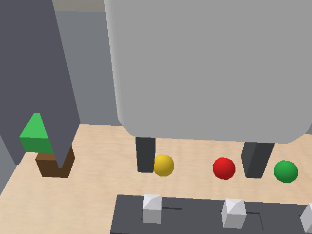
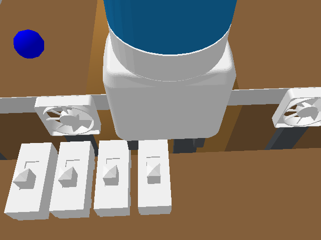
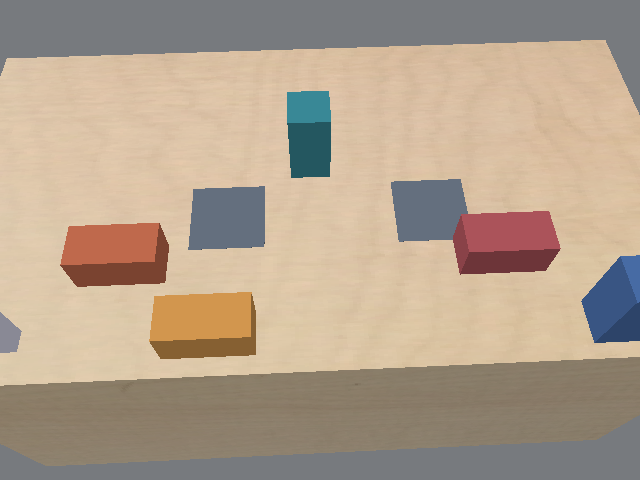
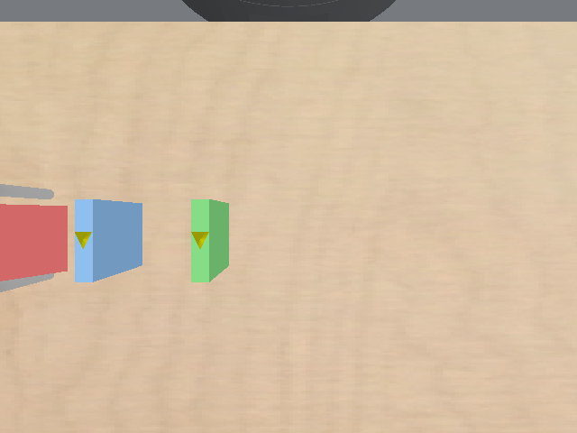

# EMPIRIC from RGB-D observations (draft design)

Status: draft for discussion, October 24, 2026.
Nothing here is built yet.
The camera numbers and images come from a one-off probe of the five benchmark scenes (see "Measurement setup" at the end).

## Goal

The agent sees the scene the way a deployed robot does: RGB-D images from a camera on its head and a camera on its wrist, plus its own joint state.
It turns those images into the object states its model needs, with point-cloud utilities and the scene's asset meshes.
A `MoveTo` skill lets it move the gripper, and with it the wrist camera, to where it needs to look or act.
The rest of EMPIRIC stays as it is: the agent-built scene model, the fit or the agent's own parameter draws, rehearsal, monitoring and the test-level gates.
They run on the states the agent estimates from its images.

## What exists today

- **Renderer.** `PyBulletEnv.render()` (`predicators/envs/pybullet_env.py`) renders RGB from one fixed external camera per env (`_camera_target`, distance, yaw, pitch, FOV in `_get_camera_matrices`).
  `render_segmented_obj()` adds per-object masks from the renderer's body ids, and `get_observation(render=True)` attaches them to the observation (the `rgb_observation` path used for VLM predicate grounding).
  `p.getCameraImage` also returns the depth buffer, which every caller throws away today.
- **The agent can already look at images.** Harness tools return image blocks (`render_pybullet_image` in `predicators/agent_sdk/tools/scene.py`), and the agent's built-in `Read` tool opens image files in its sandbox.
  Images are capped at 512 px on the long side (`agent_sdk_image_max_px`), because each one stays in the conversation.
- **What the agent observes.** `env_observe` (`predicators/agent_sdk/tools/continual_tools.py`) returns every object's features, the joint positions, the environment's atoms, a render from the external camera, and the ledger.
  `ContinualRun._observed()` (`predicators/run/continual.py`) builds that view: the sanitized state plus seeded noise on positions, orientations and scalar readings (`predicators/observation_noise.py`; `docs/uncertainty/design.md`, section 3.1).
  Every reader of one step (the observe text, the invocation's atoms, the recorded data the fit replays, the belief frame) shares that one view.
- **Skills read the true state.** A real skill call executes on the env's true state; only the agent's view is noisy.
- **The robot model has a head camera and no wrist camera.** Fetch's URDF (`predicators/envs/assets/urdf/fetch_description/robots/fetch.urdf`) has `head_pan_joint`, `head_tilt_joint` and the frames `head_camera_rgb_optical_frame` and `head_camera_depth_optical_frame`.
  The action space drives the 7 arm joints and 2 fingers; the head joints are not in it.
- **A MoveTo factory exists.** `create_move_to_skill` (`predicators/ground_truth_models/skill_factories/move_to.py`) moves the end effector to `(x, y, z, yaw)` and keeps the finger state.
  Bridge already exposes a `MoveTo` for a held object's center.
- **The scene manifest gives meshes.** The from-assets arms receive every observed object's URDF or mesh file, which is what model-based pose registration needs.
- **The real rig uses ZED cameras.** `predicators/pybullet_helpers/track_pipeline.py` runs a markerless pipeline over each recorded take and writes the pose tracks the fit reads; depth is exported offline.

## Measured: what the cameras see and what they cost

### Head camera

The URDF's head camera frame does not work as loaded.
It points away from the table, and it sits inside the head mesh, so every pixel reads a depth of 0.06 m (the first image below is all head mesh).
A camera at the same place, moved 15 cm toward the workspace and aimed at the env's existing `_camera_target`, sees most of each scene:

| Domain | Objects the aimed head camera sees |
| --- | --- |
| Balloons | balloon0-2, band, box, clip0-2 |
| Bridge | bottle, leg0-1, site0-1, span0-2 |
| Fan | ball, two boundaries, platform_0-1, ramp_0, switch_0-3 |
| Boil | burner0, burner_switch0, faucet, faucet_switch, jug0 |
| Domino | domino_0-1, target_0 |

At the robot's home pose, the arm blocks the middle of the head view in Balloons and Fan (second and third images).
The agent therefore needs a way to move the arm out of view before it looks.

### Wrist camera

A virtual camera on `gripper_link`, 4 cm behind the palm and 3 cm above its axis, looks along the approach axis.
For the top-down grasps all five domains use, that is straight down.
At the home pose it sees part of each scene from 0.2 to 1.0 m: the clips in Balloons, the spans and sites in Bridge, two switches in Fan, the jug, burner and switches in Boil, and both dominoes and the target in Domino.

### Cost

CPU rendering (PyBullet's TinyRenderer, the path a headless node takes), measured on a 2-core compute node:

| Per camera | 320 x 240 | 640 x 480 |
| --- | --- | --- |
| RGB, depth and segmentation in one call | 45 to 80 ms | 160 to 245 ms |
| Depth to a world-frame point cloud | 2 to 9 ms | 8 to 15 ms |

At one frame per camera per observation, a run of a few hundred observations spends a few minutes rendering.
Fits take 67% of a from-assets run's active time today, at 15 to 58 minutes each, so rendering is not the bottleneck.

## Design

### 1. Cameras

- **Head.** A virtual RGB-D camera anchored at `head_camera_rgb_optical_frame`, moved out of the head mesh and aimed at a per-env target.
  Each env gets a calibrated head target next to its existing `_camera_target`, checked by a test that the camera sees every manifest object of the first train and test task.
- **Wrist.** A virtual RGB-D camera on `gripper_link`, at the offset above, moving with the arm.
- **Intrinsics.** 640 x 480 with a 45-degree vertical field of view (close to Fetch's head sensor), near plane 0.05 m, far plane 5 m.
  The agent is served 320 x 240 or the 512 px cap; files keep the full resolution.
- **Depth.** Metric depth from the OpenGL buffer: `z = far * near / (far - (far - near) * d)`.
  An optional depth-noise model (noise growing with distance, quantization, missing pixels at depth edges) is seeded like today's observation noise, so a resumed run sees the same frames.
- **When frames are rendered.** On each `env_observe` call and at the end of each skill call, one frame per camera; never per physics substep.
- **Segmentation.** The same `getCameraImage` call returns body ids; a map from body id to observed object name turns them into per-object masks when the observation level includes masks (section 2).

### 2. The agent's observation, in three levels

- **O1, images added.** The agent's view stays as today (noisy object features, joint state, atoms) and gains head and wrist RGB-D.
  This is the smallest change.
  It shows whether images help, and it lets us tune cameras, tools and cost before anything depends on perception.
- **O2, images, masks and robot state.** Object features leave the agent's view.
  The agent gets RGB-D, per-object masks, its joint state and gripper pose, and the non-visual readings of section 3.
- **O3, images and robot state.** As O2, without masks: the agent also segments the images itself.
  This is closest to the real robot.

I suggest building O1 first, then O2, with O3 as the later step.

### 3. From pixels to object states (O2 and O3)

- **The agent writes the perception.** `perception.py` exports `perceive(frames, robot, previous)`.
  It returns, for each observed object, the visual features of its type (position, orientation, and articulation such as a switch slider or a clip) and, optionally, draws over them (`STATE_DRAWS`, the state counterpart of the agent-belief arm's `PARAM_DRAWS`).
- **The harness builds the frame from it.** At each observation the harness calls `perceive` and builds the agent's frame, a `State` with the env's type schema, from its output.
  `ContinualRun._observed()` is the one place this enters, so every reader that uses the frame today reads it unchanged:
  - the observe text and the invocation's atoms
  - the recorded trajectories that `sim.fit` and `sim.validate` replay
  - the belief frame and the joint draws
  - `sim.reset(current=True)`, predicates and monitoring
  The agent's scene, the fit or agent belief, rehearsal and predicates keep working as they are.
- **Non-visual quantities.** Hidden quantities (Boil's heat) stay hidden, as today.
  Process readings (water volume, spill, bubbling) and device states (a fan on or off) need a decision (see the decisions list).
  I suggest giving them to the agent as sensor readings in version 1, like its joint state, so the experiment isolates pose estimation.
- **Uncertainty.** In O2 and O3 the spread of the state belief comes from the agent's perception (its draws) in place of the declared Gaussian channel.
  The joint draws pair parameter draws with these state draws, as they pair them with noisy-frame draws today.
- **Truth logging.** The harness records the true state next to each perceived frame and never shows it to the agent.
  This gives a per-frame perception error for analysis.
- **Skills.** In version 1, skills keep executing on the true state with object arguments, as today (privileged execution).
  The agent's perception then shapes its model, its predictions and its choice of skill parameters, but a `Pick(jug0)` still finds the jug where it truly is.
  Grounding skills in the agent's estimated poses is a later step, and the real robot needs it.

### 4. Point-cloud utilities

A reference module in the sandbox, `reference/perception/pointcloud.py`, built on numpy and scipy (installed: scipy 1.9.3, scikit-learn; not installed: open3d, trimesh, OpenCV):

- `depth_to_points(depth, K)` and `to_world(points, T_world_camera)`
- `crop(points, box)` and `voxel_downsample(points, size)`
- `fit_plane` and `remove_plane` (RANSAC), for the table
- `cluster(points, eps)` (Euclidean clustering on a scipy KD-tree)
- `mask_points(points, mask)`, for O2
- `mesh_points(asset_path, n)`, sampling the manifest's OBJ and URDF primitive geometry
- `register(model, scene, init)`: point-to-point ICP on a KD-tree, returning a pose and an RMS residual, with restarts over yaw for symmetric parts
- `project(points, K, T)` and `overlay(rgb, points)`, to check an estimate by eye
- `fuse(frames)`, merging the head and wrist clouds

Each function gets a test on synthetic renders: a known box, sphere or mesh is rendered, registered and checked to within 5 mm and 2 degrees.

### 5. `MoveTo` and the head

- **`MoveTo(robot)[x, y, z, yaw]`**, built from `create_move_to_skill`, moves the end effector to a pose by motion planning and keeps the finger state.
  Its bounds are each env's reachable workspace box.
- **Uses.** Point the wrist camera at a region (active perception), move the arm out of the head camera's view, and reach approach poses.
- **Scope.** It joins this arm's skill set behind a flag at first, so no other arm's skill set changes.
- **Head.** In version 1 each env keeps a fixed, calibrated head pose.
  A later `Look(robot)[pan, tilt]`, or a head argument on `env_observe`, can turn the head kinematically, since the head joints are outside the action space.

### 6. Tools and prompt

- **`env_observe`** gains a `cameras` argument (`head`, `wrist`).
  It returns the RGB images as image blocks under the 512 px cap, plus file paths.
  It writes each frame to `frames/<level>/<step>/<camera>/`: `rgb.png`, `depth.npy` (float16 metres), `seg.npy` (O2), and `camera.json` with `K` and `T_world_camera`.
- **Skill results.** `skills_invoke` and `skills_execute_plan` list the paths of the post-skill frames; the agent opens images on request, which keeps token cost under its control.
- **Render-and-compare.** `sim.render` gains `camera="head" | "wrist"`, so the agent can render its own scene from the real camera's pose and compare it with the real frame.
- **Prompt.** A new arm section describes the cameras, the frame files, the utilities, the `perceive` contract, `MoveTo`, and what stays exact (the robot's own state and the sensor readings).

### 7. Logging, storage and cost

- **Tokens.** An image at 512 x 384 costs about 260 input tokens, and it stays in context for the rest of the session.
  Images therefore go to the agent on request; frames live on disk.
- **Disk.** One frame per camera at 320 x 240 is about 0.3 MB (RGB PNG, float16 depth, masks).
  A few hundred frames make about 100 MB per run, inside today's quota (home 54% of bytes and 60% of files).
  Frames go in the run folder so the existing archive-and-clean steps cover them.
- **Wall time.** Rendering adds minutes per run.
  The agent's perception code (ICP on 10^4 to 10^5 points) adds about 0.1 to 1 s per object per call in `run_python`.

### 8. Evaluation

- **Runs.** The same 5 domains and 2 seeds as rounds 22 and 23, with O1 and then O2 against the from-assets arm on the same tree.
- **Measures.** Solve rate, steps, perception error per frame (position in mm, yaw in degrees, from the truth log), image tokens, and wall time.

## Plan

1. **Cameras.** Head and wrist mounts per env; RGB-D and segmentation rendering; depth conversion; the optional noise model; frame files.
   Tests: a box's back-projected points lie on its faces within 2 mm, and each mount sees the manifest objects it should.
2. **Utilities.** `pointcloud.py` and its synthetic-render tests.
3. **`MoveTo`** for this arm, with reachability tests and a check of the wrist view after a move.
4. **O1 arm.** Images added to `env_observe`, the prompt section, and a 2-run pilot.
5. **O2.** The `perceive` contract, the frame plumbing in `ContinualRun._observed()`, truth logging, tests, and a pilot.
6. **O3** and pose-grounded skills, aligned with the real rig.

Each step passes the formatters, mypy, pylint and the 8 test shards before a run uses it.

## Decisions for you

1. Start at O1 (images added to today's view), or go straight to O2 (no object features)?
2. In version 1, should skills keep executing on the true state?
3. Water volume, spill, bubbling and device on/off: sensor readings, or vision?
4. Head: fixed per env, or agent-controlled pan and tilt?
5. Base arm: EMPIRIC from assets (harness fit), or the new arm with the agent's own parameter draws?

## Risks

- **Perception errors become model errors.** The fit and the belief inherit them.
  Truth logging and starting at O1 keep them visible.
- **Occlusion and small parts.** Self-occlusion by the arm and small parts (switch sliders, clips) need the wrist camera, and each `MoveTo` costs steps.
- **Context growth.** Images stay in context; the cap and the on-request rule bound it.
- **Rendering too often.** Rendering every physics substep would cost far more than every observation; frames are rendered only at observations.
- **Symmetric objects.** Spheres (balloons, the Fan ball) and boxes (blocks, dominoes) make orientation ambiguous.
  Registration needs symmetry-aware restarts, and some orientations are unobservable.

## Measurement setup

The probe built each env's first train task with the round-23 tree (`69a295899`), tilted the head 0.75 rad for the URDF-frame test, and rendered with `p.ER_TINY_RENDERER`, no shadows, on a 2-core `mit_quicktest` node.
"Objects in view" lists the observed objects whose body ids appear in the segmentation image.
The script is `~/claude_jobs/rgbd_probe/probe.py` (aimed head camera: `probe_head.py`); it is not in the repo yet and would become a test or a script in step 1.
